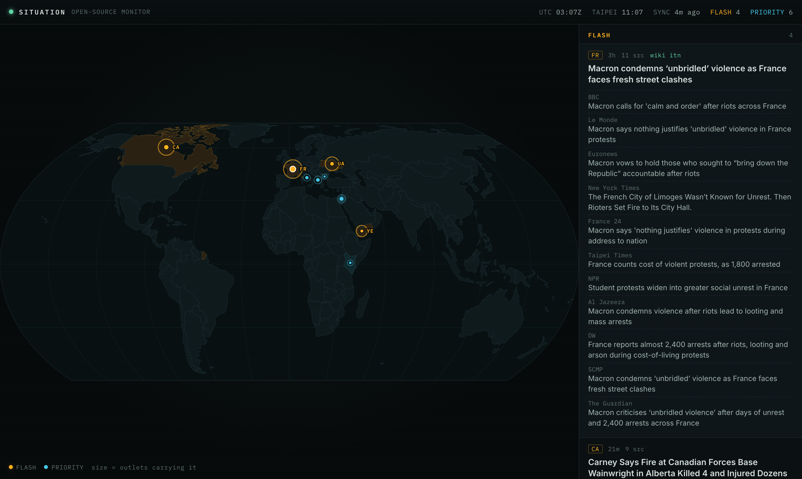

# Situation

An open-source intelligence wall for the home stack: the world map with today's major stories pinned on it, and only the headlines that clear a high bar.



## Features

- **The map** is the centrepiece. Each story is pinned where it happens, its size set by how many outlets carry it; FLASH stories pulse amber, PRIORITY stories are cyan, and their countries are tinted.
- **A high bar.** Fourteen outlets on four continents are read every 15 minutes and grouped by event. A story is shown only when several independent newsrooms carry it or Wikipedia's editors put it "In the news". A normal day shows five to ten stories out of several hundred.
- **Two tiers.** FLASH: on Wikipedia's "In the news", or led by several outlets at once. PRIORITY: carried by four or more outlets (three if one leads with it); Hong Kong, Taiwan, China and the UK get a lower bar.
- **Active situations.** Wikipedia's "Ongoing" list (wars, offensives, outbreaks), each with its latest development.
- **Sources a tap away.** Open a story to see every outlet's own headline and link.
- **Phone-first.** The map on top, the list under it.

How importance is decided, and what comes next: [`docs/plan.md`](docs/plan.md).

## Run it

```sh
uv sync
uv run flask --app app:create_app fetch                     # fetch once
uv run flask --app app:create_app run --port 8000           # http://127.0.0.1:8000
```

The server also fetches every 15 minutes on its own (`FETCH_LOOP=0` turns that off). `uv run flask --app app:create_app brief` prints today's top headlines, as the morning brief will send them.

Tests and lint: `uv run pytest` and `uvx ruff check .` The tests run on a real snapshot from 18 October 2026.

On the home stack it's added from the dashboard's Deploy tab, which reads `homestack.toml`.

### Settings

| Variable | Does |
|---|---|
| `FETCH_EVERY_MINUTES` | How often to fetch (default 15) |
| `FETCH_LOOP` | Set to `0` to fetch only by command |

Outlets, their weights and regions are in `sources.py`.

## Data

- `instance/situation.db`: articles from the last 30 days, the stories they form, and Wikipedia snapshots.
- The map is built from Natural Earth's 1:110m countries (public domain) with `python -I tools/build_map.py <countries.geojson>`; it writes `static/map/world.json` and `data/countries.json`.
- Fonts: Inter and IBM Plex Mono (SIL Open Font License), served by the app.
