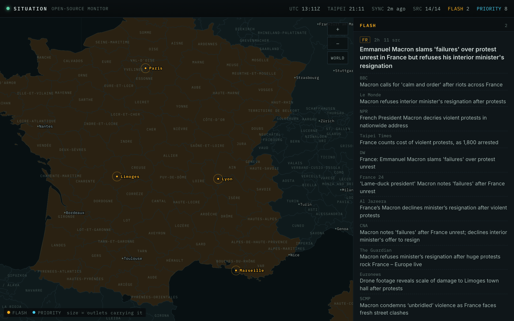
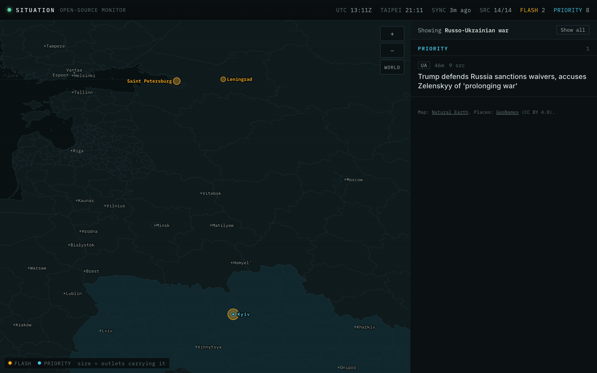
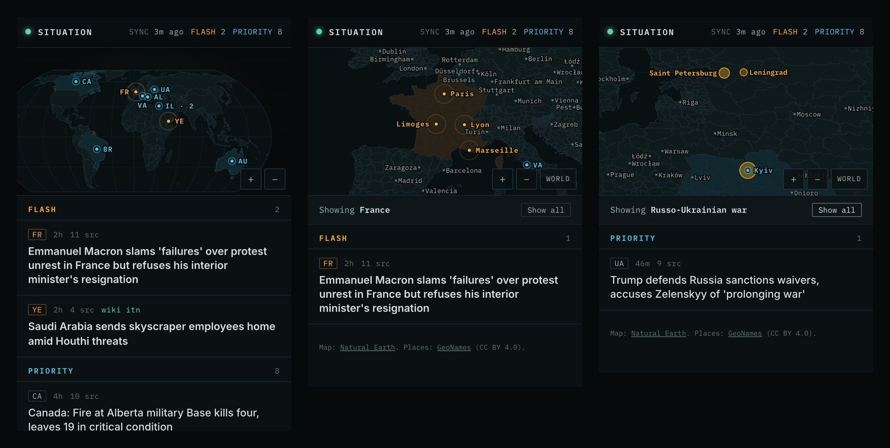

# Situation

An open-source intelligence wall for the home stack: the world map with today's major stories pinned on it, and only the headlines that clear a high bar.


<p>
  
  
</p>



## Features

- **The map** is the centrepiece. Each country with news gets one pin, sized by how many outlets carry its biggest story; FLASH pulses amber, PRIORITY is cyan. Tap a pin to see that country's stories.
- **Zoom in on a place.** Pinch, scroll or tap a country to zoom: regions and cities appear, and stories show as the places they name, such as the cities of the French riots. Tap an active situation to see every place named there in the past week, bigger the more often and fading with age. That shows where the reporting is, which isn't a verified front line.
- **The map follows what you pick.** A country, a place or an active situation filters the list and zooms the map to it; *Show all* brings back both. Moving the map yourself never changes the list, and *World* only zooms out.
- **A high bar.** Sixteen newsrooms on four continents, the AP and Reuters wires among them, are read every 15 minutes and grouped by event. A story is shown only when several independent newsrooms carry it, or Wikipedia's editors put it "In the news", which catches what these outlets under-cover. A normal day shows five to ten stories out of several hundred, and never more than ten.
- **Two tiers.** FLASH: the lead story on several front pages at once, or new on Wikipedia's "In the news" (for its first day) and carried by four or more outlets. PRIORITY: carried by four or more outlets (three if one leads with it); Hong Kong, Taiwan, China and the UK get a lower bar.
- **Today's news first.** A story fades from when it broke (full strength for 8 hours, then halving every 12) unless several outlets are still writing about it, so yesterday's big story yields to tonight's. Sport and entertainment stay below the bar.
- **Active situations.** Wikipedia's "Ongoing" list (wars, offensives, outbreaks), each with its latest development that more than one outlet carries.
- **Earlier this week.** The past seven days' stories, under today's.
- **Honest about itself.** If the news on screen is old, the server can't be reached or you've been signed out, the page says so; a feed that has gone quiet shows in the status bar.
- **Regions as areas.** Close up, a region in the news (Alberta, the Donetsk region) is tinted as its outline; cities stay dots.
- **Country cards.** Tap a country for its capital, leader, local time and when it was last in the news.
- **Local time.** Each story shows when its latest report came on the clocks where it's happening, when they differ from yours.
- **Sources a tap away.** Open a story to see every outlet's own headline and link; the map goes to the places it names, and back when you close it.
- **Phone-first.** The map on top, the list under it.

How importance is decided, and what comes next: [`docs/plan.md`](docs/plan.md).

## Run it

```sh
uv sync
uv run flask --app app:create_app fetch                     # fetch once
uv run flask --app app:create_app run --port 8000           # http://127.0.0.1:8000
```

The server also fetches every 15 minutes on its own (`FETCH_LOOP=0` turns that off). `uv run flask --app app:create_app brief` prints today's top headlines, as the morning brief will send them.

Tests and lint: `uv run pytest` and `uvx ruff check .` The tests run on real snapshots from 18–20 October 2026.

### Measuring it

`/label` (linked at the foot of the page) asks what only you can answer: which of two stories matters more, and whether you'd want a story on your page at all.

Which news articles report one event is labelled by Claude, a week at a time, into the ground truth for grouping (`evaluation/groundtruth.py`, one file per week in `instance/groundtruth/`):

```sh
uv run --with anthropic python -I tools/label_week.py /tmp/situation.db     # label last week (steps in its docstring)
uv run python -I tools/evaluate_grouping.py                                  # compare grouping methods on it
uv run flask --app app:create_app evaluate                                   # the ranking and the bar against your labels
uv run flask --app app:create_app train --save                               # fit the rank and place models, and use them
```

Grouping is scored per article (B-cubed, `evaluation/metrics.py`), over all articles and over headline-size events, with bootstrap intervals; the newest week is the test. The off-the-shelf grouping is switched on by `instance/models/meaning.json` (`{"cut": 0.5}`) and off by deleting it. What's been tried and what's next: [`docs/phases.md`](docs/phases.md).

On the home stack it's added from the dashboard's Deploy tab, which reads `homestack.toml`.

### Settings

| Variable | Does |
|---|---|
| `FETCH_EVERY_MINUTES` | How often to fetch (default 15) |
| `FETCH_LOOP` | Set to `0` to fetch only by command |
| `LEARNED` | Set to `0` to ignore trained models and use the hand rules |
| `EMBED` | Set to `0` to turn off meaning likeness (the embedding model) |
| `EMBED_MODEL_DIR` | Where the embedding model is (the image has it in `models/`) |

Outlets, their weights and regions are in `sources.py`.

## Data

- `instance/situation.db`: articles from the last 30 days, the stories they form, Wikipedia snapshots, and your labels.
- `instance/models/`: the models `flask train --save` fitted on your labels.
- `models/potion-base-8M/`: the embedding model (MIT licence, minishlab), downloaded into the image at build time.
- `instance/snapshots/`: the articles as they were when you labelled (one every 6 hours while you do; ones without labels go after 30 days).
- The map is built from Natural Earth's 1:110m countries (public domain) with `python -I tools/build_map.py <countries.geojson>`; it writes `static/map/world.json` and `data/countries.json`.
- The zoomed-in map and the place names come from Natural Earth's 1:10m countries and states/provinces, and GeoNames' towns of over 15,000 people (CC BY 4.0, [geonames.org](https://www.geonames.org/)). `tools/build_regions.py` writes `static/map/regions/<country>.json` (loaded as you zoom) and `data/gazetteer.json`; its docstring says how to run it.
- Fonts: Inter and IBM Plex Mono (SIL Open Font License), served by the app.
