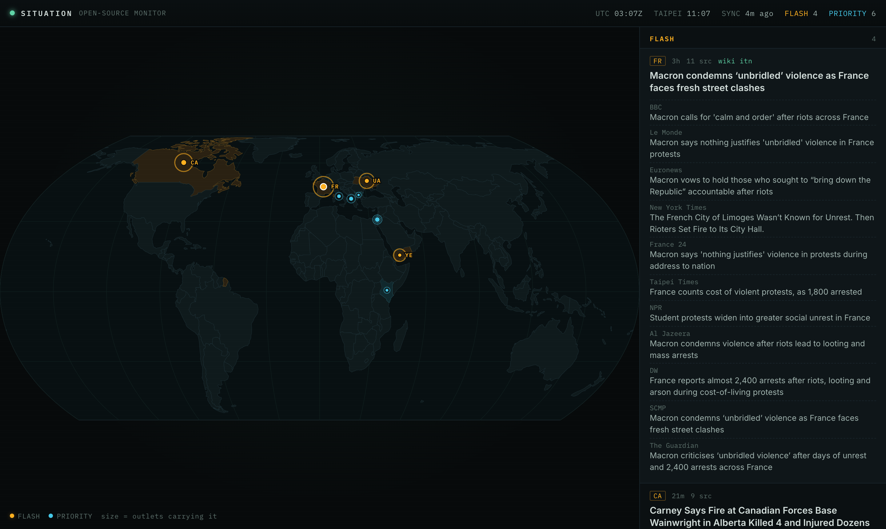
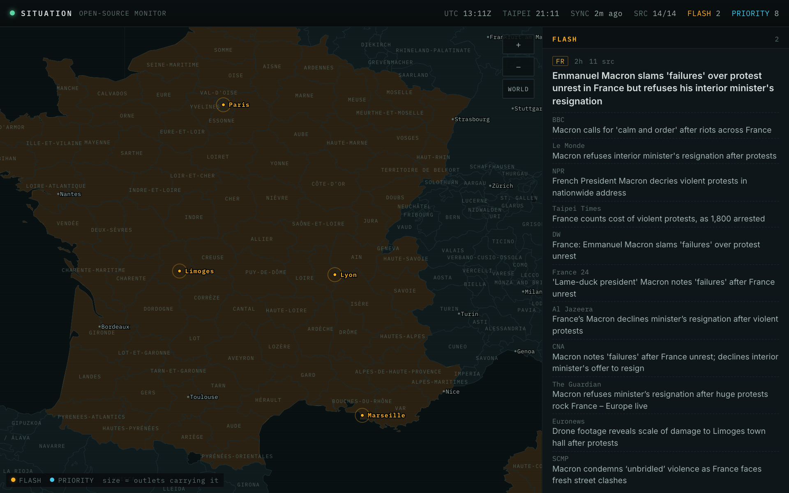
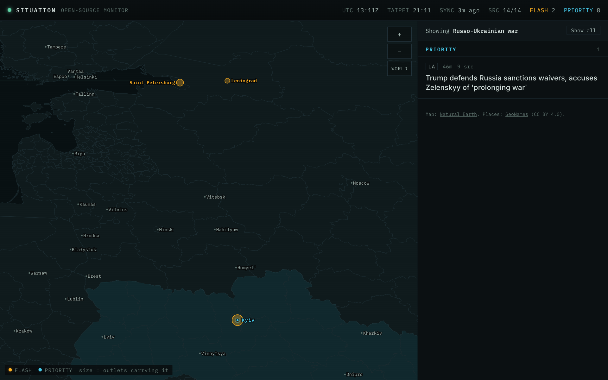
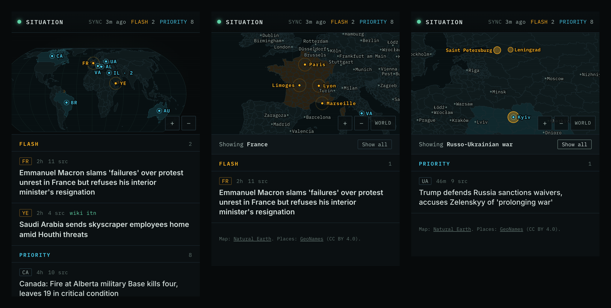

# Situation

An open-source intelligence wall for the home stack: the world map with the countries in today's major stories lit up, and only the headlines that clear a high bar.



<p>
  
  
</p>



## Features

- **The map** is the centrepiece. Each country with news is tinted, amber for FLASH and blue for PRIORITY, and named on the map; close up, cities in the news are small dots. Tap a country to see its stories. The map uses the Patterson projection, so countries keep their familiar shapes, and fills the screen edge to edge.
- **Zoom in on a place.** Pinch, scroll or tap a country to zoom: regions and cities appear, and stories show as the places they name, such as the cities of the French riots. Tap an active situation to see every place named there in the past week, bigger the more often and fading with age. That shows where the reporting is, which isn't a verified front line.
- **The map follows what you pick.** A country, a place or an active situation filters the list and zooms the map to it; *Show all* brings back both. Moving the map yourself never changes the list, and *World* only zooms out.
- **A high bar.** Sixteen newsrooms on four continents, the AP and Reuters wires among them, are read every 15 minutes and grouped by event. A story is shown only when several independent newsrooms carry it, or Wikipedia's editors put it "In the news", which catches what these outlets under-cover. A normal day shows five to ten stories out of several hundred, and never more than ten.
- **Two tiers.** FLASH: the lead story on several front pages at once, or new on Wikipedia's "In the news" (for its first day) and carried by four or more outlets. PRIORITY: carried by four or more outlets (three if one leads with it); Hong Kong, Taiwan, China and the UK get a lower bar.
- **Today's news first.** A story fades from when it broke (full strength for 8 hours, then halving every 12) unless several outlets are still writing about it, so yesterday's big story yields to tonight's. Sport and entertainment stay below the bar.
- **Running stories.** An election night, a disaster's aftermath, a summit: many events that are each small but part of one thing. Situation spots them from the news itself (the words their coverage suddenly uses, across many outlets and events, kept to one country) and shows each once, with its biggest developments under it, and FLASH while several are breaking at once. On 4 November 2026 the US midterms were one item, 14 outlets and 59 events, with the Senate calls under it, instead of a scatter of race results.
- **Signals.** What disaster monitors see, often before the news: GDACS's orange and red alerts for earthquakes, cyclones, eruptions and floods, and USGS earthquakes of magnitude 6.5 or more (or with damage expected, or a tsunami). Each is a thin coral ring on the map and a line in its own short section, shown while it happens and for two days after; when the news covers it, the story says how long before the first report it was seen.
- **Active situations.** Wikipedia's "Ongoing" list (wars, offensives, outbreaks), each with its latest development that more than one outlet carries.
- **What's new since you last looked.** Stories you haven't seen are marked *new*, and those whose headline has moved on *updated*; opening one clears it. It's kept on your device, and a first visit marks nothing.
- **Honest about itself.** If the news on screen is old, the server can't be reached or you've been signed out, the page says so; a feed that has gone quiet shows in the status bar.
- **Regions as areas.** Close up, a region in the news (Alberta, the Donetsk region) is tinted as its outline; cities stay dots.
- **Country cards.** Tap a country for its capital, leader, local time and when it was last in the news.
- **Local time.** Each story shows when its latest report came on the clocks where it's happening, when they differ from yours.
- **Sources a tap away.** Open a story to see every outlet's own headline and link; the map goes to the places it names, and back when you close it.
- **Phone-first.** The map on top, the list under it.

How importance is decided, and what comes next: [`docs/design.md`](docs/design.md).

## Dispatch

The second tab is a weekly issue to read, out each Wednesday (8am in Hong Kong) for the week before: the neuroscience the journals made more of as a front page, then a poem to learn by heart, one question about the world, and the public holidays coming up.

- **One issue a week, kept as it came out.** A paper belongs to the week it first came out, online or in print. Its issue comes out on the Wednesday after, once the journals have mostly been listed, and is fixed from then on. A paper listed too late for its own week's issue is in the next one, marked with its date. Step through issues with ‹ and › or the arrow keys; each has its own address (`/dispatch/2026-W44`; the old `/papers` addresses still lead there).
- **Only what the journals made more of.** The cover story, which leads when it's a neuroscience paper (Nature's issue page names it; Science and Neuron don't say in a form that can be read reliably), and the papers the journal commissioned a commentary on (News & Views, Perspective, Preview), with the commentary's headline under their own. They fill rows of modules that change shape from row to row, the widest figure taking the widest slot; each story's text runs to the foot of its row. On a phone it's a list.
- **Enough to skim without clicking.** The real title, first and last author, the abstract and the first figure or graphical abstract, with links to the paper, the commentary and a free copy (PubMed Central, open access or the preprint) when there is one.
- **Late commentary still counts.** Neuron's Previews come with its print issue, weeks after a paper went online: the paper appears again, with its commentary, as a story in the issue of the week the commentary came out (marked *From* its date).
- **The last four issues.** Dispatch is a periodical, not an archive: older issues and papers are forgotten after each daily read.
- **The journals.** Which journals, and how each one's neuroscience is found, is in `journals.py`: all of a neuroscience journal, a publisher's own subject feed (Nature), or the nervous-system words in the title and abstract (Science, which files nothing by subject).

The journals are read once a day from [Europe PMC](https://europepmc.org/) (abstracts, article types, free copies and PubMed's commentary links), with Crossref for a commentary's references and the publishers' pages for figures. Science's site turns automated readers away, so its papers have no figure. `uv run flask --app app:create_app papers --weeks 6` reads further back to fill earlier issues.


**The week's poem.** One poem from 唐詩三百首 or 宋詞三百首, drawn at random as the issue is published and never one still in a kept issue, set line by line in Hong Kong's characters, in Song type. The 600 poems are in `data/poems.json`, built from the [chinese-poetry](https://github.com/chinese-poetry/chinese-poetry) collection by `tools/add_poems.py`, which also cuts the typeface down to their characters.

**The week's question.** Each issue asks one yes/no question about the world from [Polymarket](https://polymarket.com) (read only; nothing is traded), to build better models of how it works by finding out whether you were right. You answer with your chance of Yes on a slider; the next issue says what happened, what you said and what the crowd said, with a Brier score for both, and keeps your record: against the crowd, how often what you said came true, and by subject.

- **Chosen by four numbers** (`forecast.py`): a yes/no market open when the issue comes out and closing before the next but at least two days after it, with the crowd between 20% and 80% and at least $25k traded, one per event (its market nearest 50%). Sports, crypto, novelty markets and anything about deaths or attacks are never asked. The most traded in the past week wins (what people are trading on now, not what has run longest), never last week's event; one within 10% of it is a tie, drawn at random.
- **What to think it through with:** the market's resolution rule and the articles Situation's newsrooms wrote on it the week before. The crowd's odds show only once you've answered, so the record is your judgement.
- **Calm about results.** A market that settles late or is disputed shows as awaiting its result and carries on into later issues until it settles; a refunded one is void and not scored. Skipped a week? You still see the answer.
- **Yours.** Answers are kept in `instance/situation.db` per signed-in user (backed up with it), never sent anywhere. `uv run flask --app app:create_app forecast` asks this week's question now and checks for results (the server does both hourly).

**Holidays.** Hong Kong's public holidays (statutory and general) in the two weeks after the issue comes out, from the `holidays` library; the section appears only when there are some. The country is `HOLIDAYS` in `dispatch.py`.

## Run it

```sh
uv sync
uv run flask --app app:create_app fetch                     # fetch once
uv run flask --app app:create_app run --port 8000           # http://127.0.0.1:8000
```

The server also fetches every 15 minutes on its own (`FETCH_LOOP=0` turns that off). `uv run flask --app app:create_app brief` prints today's top headlines, as the morning brief will send them.

Tests and lint: `uv run pytest` and `uvx ruff check .` The tests run on real snapshots from 18–20 October 2026.

### Measuring it

`/label` (linked at the foot of the page) asks what only you can answer: which of two stories matters more, and whether you'd want a story on your page at all.

Which news articles report one event is labelled by Claude, a week at a time, into the ground truth for grouping (`evaluation/groundtruth.py`, one file per week in `instance/groundtruth/`):

```sh
uv run --with anthropic python -I tools/label_week.py /tmp/situation.db     # label last week (steps in its docstring)
uv run python -I tools/evaluate_grouping.py                                  # compare grouping methods on it
uv run flask --app app:create_app evaluate                                   # the ranking and the bar against your labels
uv run flask --app app:create_app train --save                               # fit the rank and place models, and use them
```

Grouping is scored per article (B-cubed, `evaluation/metrics.py`), over all articles and over headline-size events, with bootstrap intervals; the newest week is the test. The off-the-shelf grouping is switched on by `instance/models/meaning.json` (`{"cut": 0.5}`) and off by deleting it. What's been tried and what's next: [`docs/design.md`](docs/design.md).

On the home stack it's added from the dashboard's Deploy tab, which reads `homestack.toml`.

### Settings

| Variable | Does |
|---|---|
| `FETCH_EVERY_MINUTES` | How often to fetch (default 15) |
| `FETCH_LOOP` | Set to `0` to fetch only by command |
| `LEARNED` | Set to `0` to ignore trained models and use the hand rules |
| `EMBED` | Set to `0` to turn off meaning likeness (the embedding model) |
| `EMBED_MODEL_DIR` | Where the embedding model is (the image has it in `models/`) |

Outlets, their weights and regions are in `sources.py`.

## Data

- `instance/situation.db`: articles from the last 30 days, the stories they form, Wikipedia snapshots, your labels, every paper and commentary Dispatch has read, and the week's questions with your answers.
- `instance/models/`: the models `flask train --save` fitted on your labels.
- `models/potion-base-8M/`: the embedding model (MIT licence, minishlab), downloaded into the image at build time.
- `instance/snapshots/`: the articles as they were when you labelled (one every 6 hours while you do; ones without labels go after 30 days).
- The map is built from Natural Earth's 1:110m countries (public domain) with `python -I tools/build_map.py <countries.geojson>`; it writes `static/map/world.json` and `data/countries.json`.
- The zoomed-in map and the place names come from Natural Earth's 1:10m countries and states/provinces, and GeoNames' towns of over 15,000 people (CC BY 4.0, [geonames.org](https://www.geonames.org/)). `tools/build_regions.py` writes `static/map/regions/<country>.json` (loaded as you zoom) and `data/gazetteer.json`; its docstring says how to run it.
- Fonts: Inter, IBM Plex Mono and, for the poem, 昭源宋體 Chiron Sung HK cut to the poems' characters (all SIL Open Font License), served by the app.
